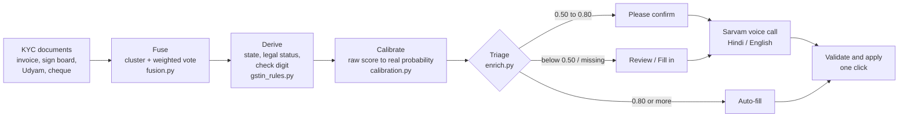
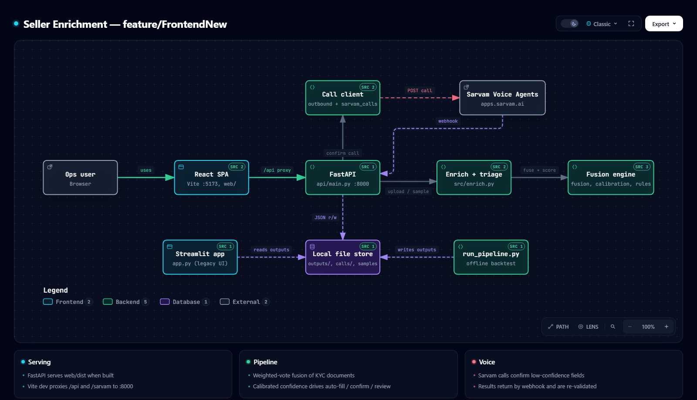

# Seller Enrichment

**From KYC documents to a verified IndiaMART seller profile.** Built for the IndiaMART Voice AI Hackathon 2.0.

A seller uploads an invoice, sign board, Udyam certificate and cancelled cheque. Someone then has to read
them and fill six profile fields. This project does the reading: it fuses the documents' extracted data,
scores every field with a calibrated confidence, and sends only the uncertain fields to a person or a
Hindi/English **Sarvam voice agent**. Nothing is scraped. Every value comes from documents the seller
already submitted, and every field is backtested against IndiaMART's own verified records.

| | |
|---|---|
| **3,000** sellers backtested | against IndiaMART's verified records, which the engine never reads |
| **44%** of fields auto-filled | **93.7%** of those correct |
| **92.4%** auto-fill accuracy on held-out sellers | calibration fit on 2,000 sellers, tested on the other 1,000 (10 splits: 91.5-92.9%) |
| **236 / 3,000** sellers fully hands-off today | the average seller needs 3.3 of 6 fields checked |

The six fields are company name, GSTIN, legal status, city, state and pincode.

## How it works



1. **Fuse** (`src/fusion.py`). Each document contributes candidate values per field, weighted by source
   reliability (Udyam 0.95, invoice 0.65, sign board 0.55, cheque 0.45). Names and addresses are clustered
   with fuzzy matching (token-sort ratio 82 or more, so "Shivay Enterprise" and "SHIVAY ENTERPRISES" merge).
   GSTIN and pincode must match exactly, because one wrong digit is a different code. The heaviest cluster
   wins, and its longest spelling is shown.
2. **Score.** `confidence = winner_share x strongest_source_weight + 0.15 per extra agreeing document`, capped at 1.
3. **Derive** (`src/gstin_rules.py`). The GSTIN carries a state code, a PAN entity character (which gives
   the legal status) and a check digit. A GSTIN that fails its check digit is the usual signature of one OCR
   misread, and triage swaps in another document's reading if that one passes.
4. **Calibrate** (`src/calibration.py`). Raw scores rank fields correctly but run low (a raw 0.5-0.6 is
   right about 77% of the time). A monotonic step map fitted on the backtest turns them into real probabilities.
5. **Triage** (`src/enrich.py`). Auto-fill, confirm, review or fill in, each with a plain-English reason.
   Evidence can only lower a bucket: a GSTIN that fails its check digit, an address state that disagrees with
   the GSTIN state code, or a material conflict between documents (dissent worth half the winner's weight or
   more) each demote a field one bucket.
6. **Confirm by voice** (`src/outbound.py`, `src/sarvam_calls.py`). The agent confirms and collects what
   triage left open. Results return by GLID, are re-validated, and are applied with one click.

A seller is **ready** only when every field is Auto-filled or Confirmed.

## Architecture



Interactive version (pan, zoom, trace paths, export): download or clone and open
[docs/architecture.html](docs/architecture.html) in a browser.

| Part | Where | Role |
|---|---|---|
| React SPA | `web/` | Enrich, Accuracy, Explorer, Phone and Sample-data views (Vite, port 5173 in dev) |
| FastAPI | `api/main.py` | REST API, Sarvam webhook, serves `web/dist` when built (port 8000) |
| Engine | `src/` | Fusion, calibration, GSTIN rules, address parsing, taxonomy, triage, validation |
| Voice | `src/outbound.py`, `src/sarvam_calls.py`, `src/voice.py` | Place or fetch calls, parse and validate replies |
| Offline backtest | `scripts/run_pipeline.py` | Scores the pipeline against the answer key, writes `outputs/` |
| Streamlit app | `app.py` | The earlier UI, still works |

## Results

Backtest on 3,000 sellers with at least one extractable document (`outputs/metrics_summary.json`):

| Field | Match rate | Basis |
|---|---|---|
| Company name | 86.7% (avg similarity 91.3) | fuzzy match, document fusion |
| GSTIN entity character | 90.8% | the dataset exposes only the privacy-safe 6th character |
| Legal status | 89.5% | deterministic GSTIN PAN-character rule |
| State | 91.5% | gazetteer match, GSTIN state-code fallback |
| Pincode | 73.7% | regex plus gazetteer |
| City | 68.2% | gazetteer match, scored by exact string |
| Field coverage | 92.6% | average 5.55 of 6 fields populated |
| Category top-5 precision | 9.1% (n=456) | keyword overlap against 696 categories; suggested, never auto-filled |

Triage across all 3,000 sellers (18,000 field decisions): 44.3% auto-filled (93.7% correct), 46.1% confirm
(74.0% correct), 2.1% review (GSTIN only), 7.4% not found in any document and collected on the call.

Calibration is re-tested on held-out sellers, so the 92.4% is not an in-sample figure (in-sample: 92.5%).
GSTIN keeps its raw score: there is no full-number ground truth to calibrate it against.

## Quick start

**1. Get the data.** The IndiaMART dataset is not in the repo (`data/raw/` is git-ignored). Place the
`so_*.csv` and `ref_*.csv` files from the four "Seller Onboarding" dataset folders in `data/raw/`.

**2. Install.**

```bash
pip install -r requirements.txt
cd web && npm install
```

On a machine whose Application Control policy blocks pip-installed compiled wheels, install pandas with
conda (`conda install -y pandas`) and the rest with pip.

**3. Run the backtest once** (writes `outputs/`, used by the Accuracy and Explorer views):

```bash
python scripts/run_pipeline.py
```

**4. Run the app.**

```bash
python -m uvicorn api.main:app --port 8000     # backend
cd web && npm run dev                          # frontend -> http://localhost:5173
```

For a single-process build: `cd web && npm run build`, then open http://localhost:8000.
The earlier Streamlit UI still works with `streamlit run app.py`.

**5. Test.**

```bash
python -m pytest
```

## Configuration

Copy [.env.example](.env.example) to `.env` (git-ignored). Everything except the voice panel works without it.

| Variable | Needed for |
|---|---|
| `SARVAM_APPS_API_KEY`, `SARVAM_ORG_ID`, `SARVAM_WORKSPACE_ID`, `SARVAM_AGENT_ID` | "Fetch latest calls", placing calls |
| `SARVAM_API_KEY` | Transliterating Hindi replies |
| `WEBHOOK_URL`, `WEBHOOK_TOKEN` | Receiving results by webhook at `/sarvam/webhook?token=...` |

Never commit keys. The agent prompt and its variable contract are in
[docs/sarvam_agent_prompt.md](docs/sarvam_agent_prompt.md).

## Phone confirmation

The call is placed from the Sarvam dashboard with the seller's GLID in the `glid` agent variable (the
panel shows the variables, and a cohort CSV for campaigns). Results come back by webhook or by the
**Fetch latest calls** button, are matched to the seller by GLID, and the panel shows per field what was
on file, whether it was confirmed, corrected or collected, and the new value. **Apply** writes the
validated values into the profile (GSTIN check digit, pincode shape, city and state lists). A call that did
not connect applies nothing. Raw phone numbers are never stored, only masked and hashed forms.

## API overview

| Endpoint | Purpose |
|---|---|
| `GET /api/meta` | Dataset and Sarvam readiness |
| `POST /api/enrich/upload`, `POST /api/enrich/sample` | Enrich uploaded or sample documents |
| `GET /api/enrich`, `GET /api/enrich/sellers/{sid}` | Triage summary and one seller |
| `POST /api/enrich/sellers/{sid}/correct` | Record a person's confirmation or edit |
| `GET /api/enrich/export.csv`, `.json` | Predicted fields with confidence scores |
| `GET /api/calls`, `POST /api/calls/sync`, `POST /api/calls/{id}/apply` | Call results and apply |
| `POST /sarvam/webhook` | Sarvam call-completion events |
| `GET /api/accuracy` | Backtest metrics at a chosen threshold |
| `GET /api/explorer/sellers`, `.../{sid}` | Browse sellers beside the answer key |

Interactive docs are at http://localhost:8000/docs while the backend runs.

## Test data

`sample_data/` holds a 10-seller pack of fictional sellers, one per scenario (complete, confirm, collect,
GSTIN misread, conflicting names, risk flag). Download it from the app (**Enrich sellers, Data format**) or
regenerate it with `python scripts/make_sample_dataset.py --check`.

## Project layout

```
api/            FastAPI app (REST + Sarvam webhook)
web/            React + Vite front end
src/            fusion, calibration, gstin_rules, address_parser, taxonomy,
                enrich (triage), validate, export, outbound, sarvam_calls, voice
scripts/        run_pipeline (backtest), make_sample_dataset, webhook_server
tests/          pytest suite (fusion, GSTIN rules)
docs/           architecture diagram, Sarvam agent prompt, session handoff
sample_data/    10-seller test pack
data/raw/       IndiaMART dataset (git-ignored, you provide it)
outputs/        generated backtest results (git-ignored)
```

## Known limitations

- **Source weights are hand-set** (0.95 / 0.65 / 0.55 / 0.45), not learned.
- **Agreement assumes independence.** Two documents can share one mistake.
- **GSTIN is checked lightly:** check digit and 6th character only, with no registry lookup.
- **City is scored by exact string.** 165 of 882 misses are "Delhi" vs "New Delhi"; counting district
  matches lifts it to at least 77%.
- **Pincode takes the first 6-digit number**, which is sometimes a phone or invoice number.
- **Name clustering is order-dependent and strict on suffixes.** "K K" vs "K.K." and "Pvt Ltd" variants can
  split a cluster; a document may also name a brand rather than the seller.
- **Only 48% of extracted documents are read.** Office-setup, product and inventory audit documents are
  extracted but unused. The dataset has document paths only, so extraction from raw images cannot be
  backtested at scale.

## Roadmap

- **Now:** city, pincode and company-name normalisation; quality gates (`isInvoice`); a second GSTIN source
  from audit documents; per-field thresholds.
- **Next:** learned weights and per-field calibration; IFSC and Udyam extras; a location-plausibility check;
  a category model using product names and HSN.
- **Later:** GST registry integration; a learning loop where every correction and call outcome becomes a
  label; more languages and a WhatsApp fallback.

## Further reading

- [docs/architecture.html](docs/architecture.html) - interactive architecture diagram
- [docs/sarvam_agent_prompt.md](docs/sarvam_agent_prompt.md) - voice agent prompt and variables
- [docs/SESSION_HANDOFF.md](docs/SESSION_HANDOFF.md) - working notes and Sarvam findings
